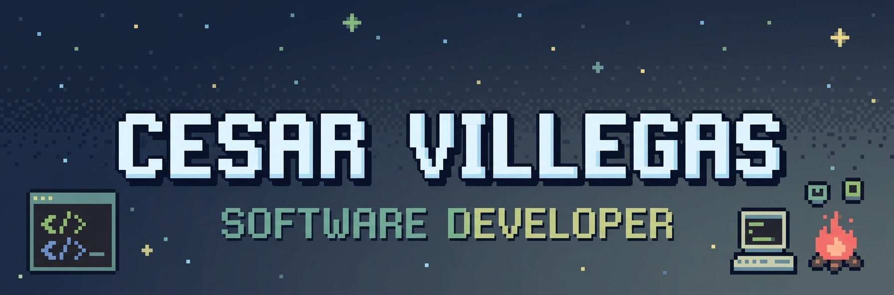

  

<h1 align="center">Hey, I'm Cesar!</h1>

  
  

- I am a Full Stack Developer from [Peru](https://www.youtube.com/watch?v=1La4QzGeaaQ) 🇵🇪
- Founder & Creator of [MonitorQ](https://github.com/cesarmiguelvillegasflores) — Logistics & Transportation SaaS

---

## Tech Stack

### Backend

  
  
  
  
  
  
  

### Frontend

  
  
  

### Tools & BaaS

  
  

---

## GitHub Stats

  

